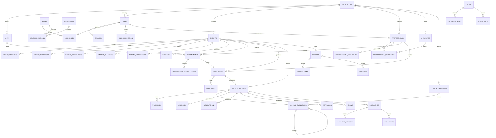

# Modelo de Dados — PostgreSQL 16

**Versão:** 1.0
**Data:** 08/11/2026
**Estado:** proposta para aprovação (Portão G2)
**Estratégia:** migrações versionadas; schema inicial em `prisma/migrations/0001_init` + SQL de RLS/triggers na mesma sequência.

---

## 1. Convenções

| Convenção | Regra |
|---|---|
| Chaves primárias | `uuid` com `gen_random_uuid()` |
| Chaves estrangeiras | `*_id`, sempre com índice |
| Tenancy | `institution_id NOT NULL` em toda tabela operacional |
| Datas | `timestamptz` em UTC; exibição em `America/Sao_Paulo` |
| Dinheiro | `bigint` em centavos (`*_cents`), nunca `float` |
| Exclusão | lógica (`deleted_at`) em cadastros; clínico **não** exclui |
| Auditoria | `created_at`, `created_by`, `updated_at`, `updated_by` |
| Nomes | `snake_case`, tabelas no plural |
| Enums | `enum` nativo do PostgreSQL para estados estáveis |
| JSONB | somente para conteúdo clínico estruturado e configurações, com schema validado na aplicação |
| Extensões | `pg_trgm` (busca), `btree_gist` (agenda), `citext` (e-mail) |

---

## 2. Visão por domínios

```
PLATAFORMA        institutions · units · departments · settings · counters
ACESSO            users · roles · permissions · role_permissions · user_roles
                  user_permissions · sessions · password_reset_tokens
PACIENTE          patients · patient_contacts · patient_addresses · patient_insurances
                  patient_allergies · patient_medications · patient_files · patient_merges
                  consents · data_subject_requests
PROFISSIONAIS     professionals · specialties · professional_specialties
                  professional_units · professional_availability · schedule_blocks
AGENDA            appointments · appointment_status_history · queue_entries
ATENDIMENTO       encounters · encounter_status_history
PRONTUÁRIO        medical_records · anamneses · clinical_evolutions · vital_signs
                  diagnoses · prescriptions · prescription_items · referrals · exams
                  clinical_templates
DOCUMENTOS        documents · document_versions · signatures · files · document_files
FINANCEIRO        services · invoices · invoice_items · payments · receipts
COMUNICAÇÃO       notifications
AUDITORIA         audit_logs · record_access_logs
```

---

## 3. Diagrama ER — núcleo clínico



---

## 4. Catálogo de tabelas

### 4.1 Plataforma e tenancy

| Tabela | Colunas principais | Restrições |
|---|---|---|
| `institutions` | `id`, `name`, `legal_name`, `cnpj` (14), `timezone`, `status`, `created_at` | `cnpj` único quando presente |
| `units` | `id`, `institution_id`, `name`, `code`, `address_*`, `phone`, `active` | único `(institution_id, code)` |
| `departments` | `id`, `unit_id`, `name`, `active` | único `(unit_id, name)` |
| `settings` | `id`, `institution_id`, `key`, `value jsonb`, `updated_by` | único `(institution_id, key)` |
| `counters` | `institution_id`, `key`, `value` | PK composta; `UPDATE ... RETURNING` para numeração |

### 4.2 Identidade e acesso

| Tabela | Colunas principais | Restrições |
|---|---|---|
| `users` | `id`, `institution_id` (nulo só para superadmin), `email citext`, `password_hash`, `full_name`, `status`, `is_superadmin`, `mfa_secret_enc`, `mfa_enabled`, `must_change_password`, `failed_attempts`, `locked_until`, `last_login_at`, `deleted_at` | e-mail único global; `CHECK (is_superadmin OR institution_id IS NOT NULL)` |
| `roles` | `id`, `institution_id` (nulo = perfil de sistema), `key`, `name`, `is_system` | único `(institution_id, key)`; `key` único global quando `is_system` |
| `permissions` | `key` (PK), `module`, `description` | catálogo imutável por migração |
| `role_permissions` | `role_id`, `permission_key` | PK composta; FK `ON DELETE CASCADE` |
| `user_roles` | `user_id`, `role_id`, `assigned_by`, `assigned_at` | PK composta |
| `user_permissions` | `user_id`, `permission_key`, `effect` (`allow`/`deny`), `granted_by`, `reason` | PK `(user_id, permission_key)` |
| `sessions` | `id`, `user_id`, `refresh_token_hash`, `device_name`, `ip inet`, `user_agent`, `created_at`, `last_used_at`, `expires_at`, `revoked_at`, `revoked_reason` | índice `(user_id, revoked_at)` |
| `password_reset_tokens` | `id`, `user_id`, `token_hash`, `expires_at`, `used_at` | uso único |

> **Superadministrador:** `is_superadmin = true`, `institution_id = NULL`. Não recebe PHI por padrão; acesso a dados de uma instituição exige impersonação explícita, com justificativa e auditoria.

### 4.3 Pacientes

| Tabela | Colunas principais | Restrições |
|---|---|---|
| `patients` | `id`, `institution_id`, `record_number`, `full_name`, `social_name`, `birth_date`, `sex`, `gender_identity`, `cpf` (11), `rg`, `cns` (15), `email`, `marital_status`, `occupation`, `notes`, `status`, `merged_into_id`, `created_by`, `deleted_at` | único `(institution_id, record_number)`; único parcial `(institution_id, cpf) WHERE cpf IS NOT NULL AND deleted_at IS NULL`; índice trigram em `full_name` |
| `patient_contacts` | `id`, `patient_id`, `type` (`phone`/`email`/`whatsapp`), `value`, `is_primary`, `verified_at` | um primário por tipo (índice único parcial) |
| `patient_addresses` | `id`, `patient_id`, `label`, `street`, `number`, `complement`, `district`, `city`, `state` (2), `postal_code` (8), `is_primary` | um primário por paciente |
| `patient_insurances` | `id`, `patient_id`, `provider`, `plan`, `card_number`, `valid_until`, `is_primary` | — |
| `patient_allergies` | `id`, `patient_id`, `substance`, `reaction`, `severity`, `noted_by`, `noted_at`, `active` | alerta destacado no prontuário |
| `patient_medications` | `id`, `patient_id`, `name`, `dose`, `frequency`, `start_date`, `end_date`, `prescribed_by`, `active` | — |
| `patient_files` | `id`, `patient_id`, `file_id`, `category`, `description` | — |
| `patient_merges` | `id`, `institution_id`, `source_patient_id`, `target_patient_id`, `merged_by`, `merged_at`, `reason` | preserva histórico da fusão |
| `consents` | `id`, `patient_id`, `type`, `granted`, `granted_at`, `revoked_at`, `evidence_file_id`, `notes` | — |

### 4.4 Profissionais e especialidades

| Tabela | Colunas principais | Restrições |
|---|---|---|
| `specialties` | `id`, `institution_id` (nulo = catálogo global), `key`, `name`, `council`, `requires_registration`, `active` | único `(institution_id, key)` |
| `professionals` | `id`, `institution_id`, `user_id`, `full_name`, `cpf`, `council`, `registration_number`, `registration_state`, `primary_specialty_id`, `status`, `signature_title` | único `(institution_id, council, registration_number, registration_state)` |
| `professional_specialties` | `professional_id`, `specialty_id`, `is_primary` | PK composta |
| `professional_units` | `professional_id`, `unit_id` | PK composta |
| `professional_availability` | `id`, `professional_id`, `unit_id`, `weekday` (0–6), `start_time`, `end_time`, `slot_minutes`, `valid_from`, `valid_to` | `CHECK (end_time > start_time)` |
| `schedule_blocks` | `id`, `professional_id`, `unit_id`, `starts_at`, `ends_at`, `reason`, `created_by` | `CHECK (ends_at > starts_at)` |

### 4.5 Agenda e atendimento

| Tabela | Colunas principais | Restrições |
|---|---|---|
| `appointments` | `id`, `institution_id`, `unit_id`, `patient_id`, `professional_id`, `specialty_id`, `starts_at`, `ends_at`, `type`, `status`, `reason`, `notes`, `created_by`, `cancelled_at`, `cancel_reason`, `rescheduled_from_id`, `checked_in_at`, `started_at`, `finished_at` | `CHECK (ends_at > starts_at)`; **exclusão** de sobreposição por profissional |
| `appointment_status_history` | `id`, `appointment_id`, `from_status`, `to_status`, `changed_by`, `changed_at`, `reason` | append-only |
| `queue_entries` | `id`, `institution_id`, `unit_id`, `patient_id`, `appointment_id`, `priority`, `status`, `entered_at`, `called_at`, `finished_at` | — |
| `encounters` | `id`, `institution_id`, `unit_id`, `patient_id`, `professional_id`, `specialty_id`, `appointment_id`, `type`, `status`, `started_at`, `ended_at`, `chief_complaint`, `created_by` | `appointment_id` único quando presente |
| `encounter_status_history` | `id`, `encounter_id`, `from_status`, `to_status`, `changed_by`, `changed_at` | append-only |

**Constraint de agenda (exemplo):**

```sql
ALTER TABLE appointments
  ADD CONSTRAINT appointments_no_overlap
  EXCLUDE USING gist (
    professional_id WITH =,
    tstzrange(starts_at, ends_at, '[)') WITH &&
  )
  WHERE (status NOT IN ('cancelled', 'no_show'));
```

### 4.6 Prontuário

| Tabela | Colunas principais | Restrições |
|---|---|---|
| `medical_records` | `id`, `institution_id`, `patient_id`, `encounter_id`, `professional_id`, `status`, `opened_at`, `closed_at` | `encounter_id` único quando presente |
| `anamneses` | `id`, `record_id`, `professional_id`, `chief_complaint`, `history_present_illness`, `past_history`, `family_history`, `social_history`, `allergies_snapshot`, `medications_snapshot`, `structured jsonb`, `status`, `content_hash`, `finalized_at`, `finalized_by` | uma anamnese finalizada por record |
| `clinical_evolutions` | `id`, `institution_id`, `record_id`, `patient_id`, `professional_id`, `template_id`, `template_version`, `content jsonb`, `content_text`, `status` (`draft`/`final`/`amended`), `revision`, `content_hash`, `finalized_at`, `finalized_by`, `amends_id`, `amend_reason`, `created_by` | único `(record_id, revision)`; `amends_id` FK para si |
| `vital_signs` | `id`, `encounter_id`, `patient_id`, `measured_at`, `systolic`, `diastolic`, `heart_rate`, `respiratory_rate`, `temperature_c`, `spo2`, `weight_kg`, `height_cm`, `bmi`, `glucose`, `pain_scale`, `recorded_by` | `CHECK` de faixas plausíveis |
| `diagnoses` | `id`, `record_id`, `patient_id`, `professional_id`, `cid10_code`, `description`, `type` (`primary`/`secondary`), `status` (`active`/`resolved`/`suspected`), `onset_date`, `resolved_date`, `notes` | código CID-10 validado |
| `prescriptions` | `id`, `record_id`, `patient_id`, `professional_id`, `type` (`simple`/`controlled`), `status`, `issued_at`, `content_hash`, `notes` | controlada exige habilitação do profissional |
| `prescription_items` | `id`, `prescription_id`, `medication`, `dosage`, `route`, `frequency`, `duration`, `quantity`, `instructions` | — |
| `referrals` | `id`, `record_id`, `patient_id`, `from_professional_id`, `to_specialty_id`, `reason`, `urgency`, `status`, `issued_at` | — |
| `exams` | `id`, `record_id`, `patient_id`, `type` (`requested`/`result`), `name`, `requested_at`, `result_summary`, `result_file_id`, `status` | — |
| `clinical_templates` | `id`, `institution_id`, `specialty_id`, `type`, `name`, `schema jsonb`, `text_template`, `version`, `active`, `created_by` | único `(institution_id, type, name, version)` |

**Regras clínicas:**

- `clinical_evolutions.status = 'final'` é imutável (trigger).
- Correção cria nova linha com `amends_id` apontando para a original e `amend_reason` obrigatório.
- `content_hash = sha256(content_text)` calculado no servidor ao finalizar.
- O prontuário **nunca** é apagado; retenção segue política legal.

### 4.7 Documentos e arquivos

| Tabela | Colunas principais | Restrições |
|---|---|---|
| `documents` | `id`, `institution_id`, `patient_id`, `record_id`, `type`, `title`, `status`, `current_version`, `issued_at`, `issued_by`, `content_hash` | — |
| `document_versions` | `id`, `document_id`, `version`, `content_html`, `content_hash`, `pdf_file_id`, `created_by`, `created_at` | único `(document_id, version)`; append-only |
| `signatures` | `id`, `document_id`, `version`, `signer_user_id`, `signer_professional_id`, `type` (`simple`/`qualified`), `certificate_subject`, `signed_at`, `hash_algorithm`, `signature_value`, `ip`, `user_agent` | `type` distingue explicitamente simples de qualificada |
| `files` | `id`, `institution_id`, `storage_key`, `filename`, `mime`, `size_bytes`, `sha256`, `uploaded_by`, `created_at`, `deleted_at` | `storage_key` único |
| `document_files` | `document_id`, `file_id`, `kind` (`pdf`/`attachment`) | PK composta |

### 4.8 Financeiro

| Tabela | Colunas principais | Restrições |
|---|---|---|
| `services` | `id`, `institution_id`, `code`, `name`, `price_cents`, `specialty_id`, `active` | único `(institution_id, code)` |
| `invoices` | `id`, `institution_id`, `patient_id`, `encounter_id`, `number`, `status`, `total_cents`, `issued_at`, `due_date`, `created_by` | único `(institution_id, number)` |
| `invoice_items` | `id`, `invoice_id`, `service_id`, `description`, `quantity`, `unit_price_cents`, `discount_cents`, `total_cents` | `CHECK (total_cents >= 0)` |
| `payments` | `id`, `invoice_id`, `method`, `amount_cents`, `paid_at`, `received_by`, `notes`, `idempotency_key` | único `(invoice_id, idempotency_key)` |
| `receipts` | `id`, `payment_id`, `number`, `pdf_file_id`, `issued_at` | único `(institution_id, number)` |

### 4.9 Comunicação, auditoria e LGPD

| Tabela | Colunas principais | Observação |
|---|---|---|
| `notifications` | `id`, `institution_id`, `user_id`, `type`, `title`, `body`, `read_at`, `created_at` | sem PHI no corpo |
| `audit_logs` | `id`, `institution_id`, `actor_user_id`, `action`, `entity_type`, `entity_id`, `patient_id`, `request_id`, `ip`, `user_agent`, `metadata jsonb`, `created_at` | append-only; particionada por mês |
| `record_access_logs` | `id`, `institution_id`, `user_id`, `patient_id`, `record_id`, `action` (`view`/`export`/`print`), `ip`, `created_at` | alto volume; particionada |
| `data_subject_requests` | `id`, `institution_id`, `patient_id`, `type` (`export`/`correction`/`anonymization`), `status`, `requested_at`, `completed_at`, `handled_by`, `notes` | fluxo LGPD |

---

## 5. Enums principais

```sql
CREATE TYPE user_status       AS ENUM ('active', 'inactive', 'blocked', 'pending');
CREATE TYPE patient_status    AS ENUM ('active', 'inactive', 'deceased', 'merged');
CREATE TYPE appointment_status AS ENUM (
  'scheduled', 'confirmed', 'waiting', 'in_progress',
  'completed', 'cancelled', 'no_show'
);
CREATE TYPE encounter_status  AS ENUM ('open', 'in_progress', 'finished', 'cancelled');
CREATE TYPE record_status     AS ENUM ('draft', 'final', 'amended', 'cancelled');
CREATE TYPE signature_type    AS ENUM ('simple', 'qualified');
CREATE TYPE invoice_status    AS ENUM ('draft', 'issued', 'paid', 'partially_paid', 'cancelled', 'overdue');
CREATE TYPE payment_method    AS ENUM ('cash', 'pix', 'debit', 'credit', 'transfer', 'insurance', 'other');
CREATE TYPE permission_effect AS ENUM ('allow', 'deny');
CREATE TYPE audit_action      AS ENUM ('create', 'read', 'update', 'delete', 'finalize', 'amend', 'export', 'print', 'login', 'logout', 'block', 'restore');
```

---

## 6. Índices e constraints essenciais

```sql
-- Busca de paciente por nome (trigram)
CREATE INDEX patients_name_trgm_idx
  ON patients USING gin (full_name gin_trgm_ops)
  WHERE deleted_at IS NULL;

-- Listagens por instituição e data
CREATE INDEX appointments_institution_starts_idx
  ON appointments (institution_id, starts_at DESC);
CREATE INDEX encounters_institution_started_idx
  ON encounters (institution_id, started_at DESC);
CREATE INDEX evolutions_record_created_idx
  ON clinical_evolutions (record_id, created_at DESC);

-- Prontuário: uma evolução final por revisão
CREATE UNIQUE INDEX evolutions_record_revision_uidx
  ON clinical_evolutions (record_id, revision);

-- CPF único por instituição (quando informado e não excluído)
CREATE UNIQUE INDEX patients_cpf_uidx
  ON patients (institution_id, cpf)
  WHERE cpf IS NOT NULL AND deleted_at IS NULL;

-- Sessões ativas
CREATE INDEX sessions_active_idx
  ON sessions (user_id, expires_at)
  WHERE revoked_at IS NULL;

-- Auditoria por paciente e período
CREATE INDEX audit_patient_created_idx
  ON audit_logs (institution_id, patient_id, created_at DESC);
```

**Integridade referencial:** todas as FKs com `ON DELETE RESTRICT` por padrão. Exceções explícitas: vínculos (roles/permissões) usam `CASCADE`; dados clínicos **nunca** usam `CASCADE`.

---

## 7. RLS — isolamento por instituição

```sql
-- Papel da aplicação, sem BYPASSRLS
CREATE ROLE app_user LOGIN PASSWORD '...';
GRANT USAGE ON SCHEMA public TO app_user;
GRANT SELECT, INSERT, UPDATE, DELETE ON ALL TABLES IN SCHEMA public TO app_user;

-- Função auxiliar
CREATE FUNCTION current_institution() RETURNS uuid
LANGUAGE sql STABLE AS $$
  SELECT nullif(current_setting('app.institution_id', true), '')::uuid
$$;

-- Exemplo em patients
ALTER TABLE patients ENABLE ROW LEVEL SECURITY;
ALTER TABLE patients FORCE ROW LEVEL SECURITY;

CREATE POLICY patients_tenant ON patients
  USING (institution_id = current_institution())
  WITH CHECK (institution_id = current_institution());
```

- Aplicar o mesmo padrão a **todas** as tabelas com `institution_id`.
- Tabelas filhas (sem `institution_id`) usam `EXISTS` sobre o pai.
- `audit_logs` e `record_access_logs`: `INSERT` permitido, `UPDATE`/`DELETE` revogados.
- Teste automatizado percorre o catálogo e falha se alguma tabela com `institution_id` estiver sem RLS.

---

## 8. Imutabilidade e triggers

### 8.1 Bloqueio de alteração de registro finalizado

```sql
CREATE OR REPLACE FUNCTION prevent_finalized_change()
RETURNS trigger LANGUAGE plpgsql AS $$
BEGIN
  IF OLD.status = 'final' THEN
    RAISE EXCEPTION 'Registro finalizado não pode ser alterado. Use adendo.'
      USING ERRCODE = 'check_violation';
  END IF;
  RETURN NEW;
END;
$$;

CREATE TRIGGER clinical_evolutions_immutable
  BEFORE UPDATE OR DELETE ON clinical_evolutions
  FOR EACH ROW EXECUTE FUNCTION prevent_finalized_change();
```

### 8.2 Hash ao finalizar

```sql
CREATE OR REPLACE FUNCTION set_evolution_hash()
RETURNS trigger LANGUAGE plpgsql AS $$
BEGIN
  IF NEW.status = 'final' AND OLD.status = 'draft' THEN
    NEW.content_hash := encode(digest(NEW.content_text, 'sha256'), 'hex');
    NEW.finalized_at := now();
  END IF;
  RETURN NEW;
END;
$$;
```

### 8.3 Append-only na auditoria

```sql
REVOKE UPDATE, DELETE ON audit_logs, record_access_logs FROM app_user;
```

---

## 9. Numeração de prontuário

- `patients.record_number` é sequencial **por instituição**.
- Gerado em transação com `UPDATE counters SET value = value + 1 WHERE institution_id = $1 AND key = 'patient_record' RETURNING value`.
- Constraint única impede duplicidade mesmo sob concorrência.
- Formato de exibição: `P-000123` (configurável por instituição).

---

## 10. Retenção e LGPD

| Dado | Retenção | Ação |
|---|---|---|
| Prontuário clínico | mínimo legal aplicável (definir com jurídico; referência CFM: 20 anos) | nunca excluir por rotina |
| Auditoria | 5 anos (configurável) | particionar e arquivar |
| Logs técnicos | 90 dias | rotação |
| Sessões | 30 dias após expiração | expurgo |
| Tokens de reset | 24 h após uso/expiração | expurgo |
| Anexos | conforme vínculo clínico | exclusão lógica + auditoria |
| Backup | 30 diários / 12 mensais / 5 anuais | rotação |

**Direitos do titular:** exportação, correção e anonimização passam por `data_subject_requests`, com validação de identidade, autorização e auditoria. Anonimização não pode destruir registro clínico obrigatório; o fluxo jurídico define o limite.

---

## 11. Estratégia de migração

1. Toda alteração de schema é uma migração versionada e imutável.
2. Migrações rodam com usuário `migrator`, separado do `app_user`.
3. Antes de migrar em produção: backup verificado + janela + plano de rollback.
4. Seeds:
   - `seed:permissions` — catálogo de permissões (idempotente).
   - `seed:roles` — perfis de sistema.
   - `seed:specialties` — catálogo inicial (13 especialidades).
   - `seed:admin` — cria superadministrador a partir de variáveis de ambiente, exigindo troca de senha no primeiro acesso.
5. Dados sintéticos de desenvolvimento ficam em `seed:dev` e **nunca** rodam em produção.

---

## 12. O que o modelo garante

| Requisito | Como é garantido |
|---|---|
| Não misturar instituições | `institution_id` + RLS + guard + testes |
| Autoria | `created_by`/`professional_id` + auditoria |
| Data/hora confiável | `now()` do servidor, UTC |
| Registro finalizado não é sobrescrito | trigger + status + hash |
| Correção rastreável | `amends_id` + `amend_reason` + revisões |
| Documento emitido é verificável | `content_hash` + versão + assinatura |
| Financeiro sem erro de arredondamento | centavos em `bigint` |
| Agenda sem double booking | constraint de exclusão `gist` |
| Busca de paciente rápida | índice trigram |
| Auditoria sem PHI em log | metadados + IDs, conteúdo só no banco clínico |
